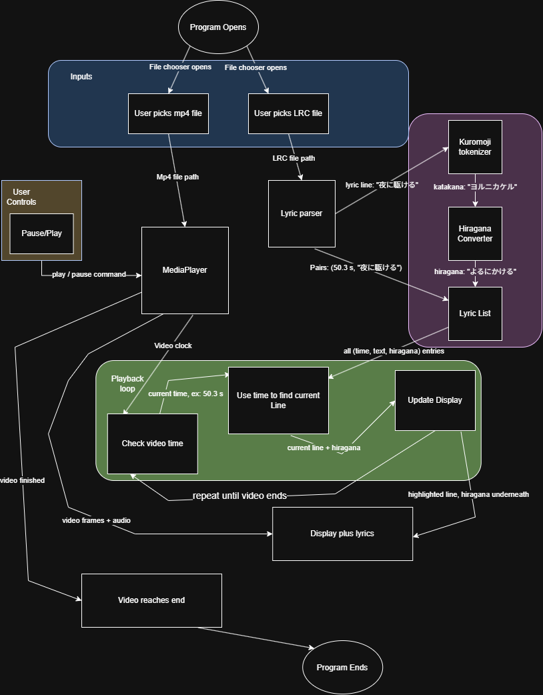

# LearnByKaraoke

A Java app that plays a music video with synced lyrics and shows a hiragana reading under each line, so you can practice reading Japanese while singing along.

## The Problem

I'm learning Japanese and can barely read it yet (around N5 level). I love japanese music and want to sing along, but lyrics sites only show kanji I can't read, or romaji that doesn't teach me anything (or are simply boring to use). I wanted a tool that plays the music video, follows the lyrics in time, and shows me the hiragana so I'm practicing real reading as I go.

## How It Works

You pick an mp4 music video and a timestamped LRC lyrics file. The video plays, and the app highlights the current lyric line in time with it. Under each line it shows the hiragana reading, generated automatically.

**Version 1.0 (MVP):**
- Play a local mp4 with play/pause controls
- Parse an LRC file into (timestamp, lyric) pairs
- Highlight the current line, synced to the video's playback time
- Show a hiragana reading under each line
- File chooser to load any mp4 + LRC pair

## Roadmap (V2.0+)

- [ ] Click a word to see its English meaning (JMdict)
- [ ] Romaji display, with the option to hide it for kana you already know
- [ ] Tap-to-time editor for songs without an LRC file
- [ ] Kanji with furigana
- [ ] Override file for incorrect hiragana readings
- [ ] Save looked-up words to a vocab list / export to Anki

## Tech Stack

- **Language:** Java
- **Libraries:** JavaFX (video playback and GUI), Kuromoji (word splitting and readings), Gson (V2, for reading the dictionary file)
- **Build tool:** Maven
- **External tools:** ffmpeg (to re-encode videos JavaFX can't play)
- **Storage:** plain local files, no database

## Setup

Setup steps will be added once the first working version exists, so everything listed here has been tested.

You will need to supply your own mp4 and LRC files. They aren't included in this repo.

## Documentation

- [Eisenhower Matrix](CS-19-Project-Doc.pdf)
- [System diagram source (draw.io)](MyArchitectDiaphram.drawio)
